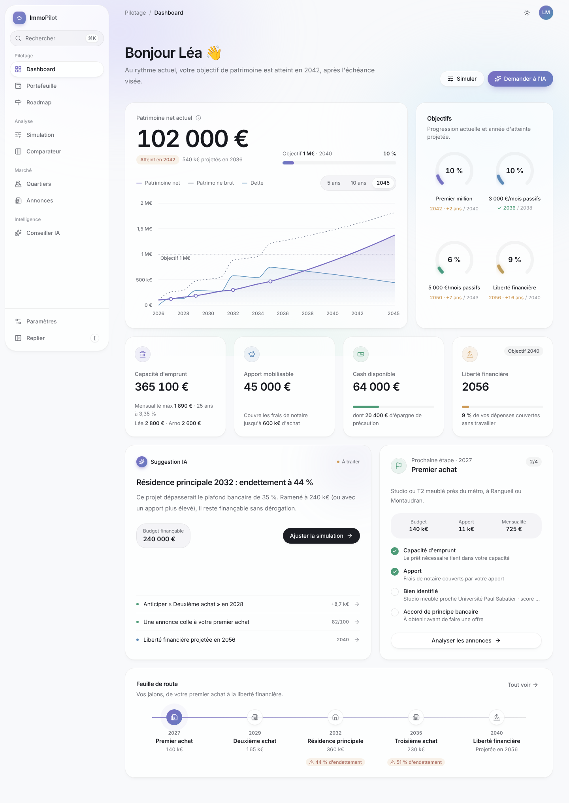

# ImmoPilot

> Le copilote IA pour construire son patrimoine immobilier.

ImmoPilot aide à décider s'il vaut mieux **acheter sa résidence principale**, **investir dans le locatif**, ou **combiner les deux**, à partir de projections financières chiffrées, d'un marché local noté (Toulouse) et d'un conseiller IA.



## Démarrage

```bash
pnpm install
cp .env.example .env
docker compose up -d          # PostgreSQL 16 (ou n'importe quel Postgres)
pnpm db:migrate && pnpm db:seed
pnpm dev                      # http://localhost:3000
```

| Commande                           | Rôle                                                |
| ---------------------------------- | --------------------------------------------------- |
| `pnpm validate`                    | typecheck + lint + format + tests unitaires         |
| `pnpm test` / `pnpm test:coverage` | Vitest (jsdom)                                      |
| `pnpm test:e2e`                    | Playwright, desktop + mobile (lance `next start`)   |
| `pnpm storybook`                   | Design system isolé, thème clair/sombre, audit a11y |
| `pnpm db:studio`                   | Explorer la base                                    |

## Stack

Next.js 15 (App Router, RSC, typed routes) · TypeScript strict · Tailwind CSS 4 · composants façon shadcn sur Radix · Framer Motion · Recharts · React Hook Form + Zod · Prisma + PostgreSQL · TanStack Query · Zustand · Vitest · Playwright · Storybook 9 · ESLint · Prettier · Husky + lint-staged · Vercel Analytics.

## Architecture

```
src/
  app/            Routes (App Router). Pages fines : elles chargent un modèle et le rendent.
  features/       Une fonctionnalité = un dossier autonome
    <feature>/
      components/   UI de la fonctionnalité
      lib/          Composition pure et testée (aucune I/O)
      server/       Points d'entrée serveur (session + services → lib)
      index.ts      API publique de la fonctionnalité
  components/
    ui/           Design system (primitives sans logique métier — règle ESLint)
    layout/       Shell : sidebar, topbar, navigation mobile, ⌘K
    charts/       Thème et tooltips partagés des graphiques
    motion/       Primitives d'animation
    providers/    Providers client racine
  lib/
    finance/      Moteur financier pur (crédit, capacité, fiscalité, projection…)
    insights/     Moteur de recommandations déterministe
    auth/         Session (point d'extension unique pour l'authentification)
    db.ts         Client Prisma
  services/       Accès aux données (Prisma → DTO sérialisables)
  config/         Site, navigation, motion, environnement (validé par Zod)
  store/          État UI global (Zustand, par requête)
  hooks/ utils/ types/ fixtures/ styles/
prisma/           Schéma, migrations, seed
tests/            Setup Vitest, mocks, e2e Playwright
```

**Principes**

- **Flux de données à sens unique** : `page (RSC)` → `features/*/server` → `services` (Prisma → DTO) → `features/*/lib` (pur) → composants. Aucun calcul dans les composants.
- **Le moteur financier ne connaît ni React ni Next** ; il est testé à 98 % (lignes) et 100 % (fonctions).
- **Les DTO sont sérialisables** (nombres, chaînes) : les `Decimal` Prisma ne franchissent jamais la frontière serveur/client.
- **Les chiffres affichés par « l'IA » sont calculés**, jamais générés : le conseiller (sprint 7) racontera les faits produits par `lib/insights`.

## Moteur financier (`src/lib/finance`)

| Fonction                                                                | Rôle                                                                                  |
| ----------------------------------------------------------------------- | ------------------------------------------------------------------------------------- |
| `calculateMonthlyPayment`, `calculateRemainingCapital`, `calculateLoan` | Prêt amortissable, assurance sur capital initial, tableau annuel                      |
| `calculateCapacity`, `calculateDebtRatio`                               | Règle HCSF 35 %, loyers retenus à 70 %                                                |
| `calculateEquity`, `calculateNetWorth`                                  | Patrimoine brut / net                                                                 |
| `calculateTaxes`, `calculateLmnpDepreciation`                           | Micro-foncier, réel, micro-BIC, LMNP réel                                             |
| `calculateRentability`, `calculateCashflow`                             | Rendements brut / net / net-net, cash-flow                                            |
| `calculateTimeline`                                                     | Projection année par année (achats, épargne, loyers, crédits, impôts, revalorisation) |
| `calculateFreedom`, `calculateGoalsProgress`                            | Liberté financière et objectifs                                                       |

Définitions : **revenus passifs** = loyers nets (après vacance, charges, taxe foncière et impôts) + 3,5 % des placements ; **liberté financière** = cash-flow locatif _après mensualités_ + 3,5 % des placements ≥ dépenses de vie (logement compris).

## Design system

Tokens OKLCH à faible chroma (`src/styles/tokens.css`), ombres multicouches, verre dépoli, rayons 16/20/24 px, Inter variable auto-hébergée, langage de mouvement à ressorts (`src/config/motion.ts`), `prefers-reduced-motion` respecté. Vitrine interactive : `/design-system` (ou ⌘K → « Design System ») et Storybook.

Raccourcis : `⌘K` palette, `G` puis `D/S/C/Q/A/P/R/I` pour naviguer, `[` pour replier la sidebar.

## Sprints

Voir [docs/sprints.md](docs/sprints.md).
